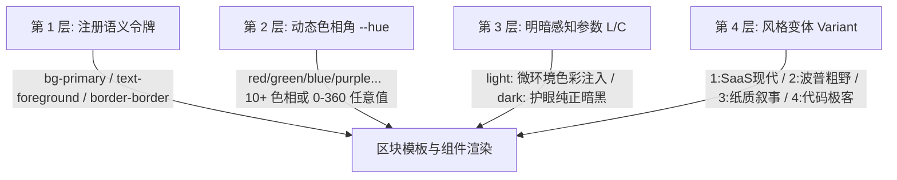

# 架构与覆盖规范

VueBlocks 采用**“OKLCH 动态主题 × 风格变体 × 属性智能合并 × 插槽兜底”**的分层递进架构设计。

---

## 🎨 OKLCH 四层正交解耦动态主题体系

VueBlocks 基于先进的 **OKLCH 感知均匀色彩模型** 与 Tailwind CSS 4 `@theme inline` 规范，实现了 **风格骨架（Variant）× 主题色相（Theme）× 明暗模式（Mode）** 的三维完全正交解耦：



1. **第一层：Tailwind 4 语义令牌层 (`@theme inline`)**
   - 暴露统一的语义化类名：`bg-background`、`text-foreground`、`bg-primary`、`text-primary-foreground`、`bg-card`、`border-border` 等。
   - 所有区块代码内部 **零硬编码 HEX 色值**，任何主题变化均能精准全局响应。
2. **第二层：动态色相角控制层 (`--hue`)**
   - 将主色调解构为 0° ~ 360° 的 OKLCH 色相角度。
   - 内置 10+ 款高保真预设主题别名：`blue` (255°), `indigo` (270°), `purple` (300°), `pink` (345°), `red` (25°), `orange` (55°), `yellow` (85°), `green` (145°), `emerald` (155°), `cyan` (200°)，并支持任意数值色相实时注入。
3. **第三层：明暗与色度参数层 (`--primary-l`, `--bg-c` 等)**
   - 彻底摆脱传统 HSL/RGB 切换色相时不同颜色明度跳跃失衡（例如纯黄刺眼、纯蓝暗淡）的问题。
   - **浅色模式**：注入微色相环境色（`--bg-c: 0.008`），呈现如同纸质印刷般的温润质感。
   - **深色模式**：采用高对比度但温和的护眼暗黑配方，主色前景字始终维持高对比度白光，杜绝深色模式下文字发黑看不清的缺陷。
4. **第四层：风格变体体系 (`variant`)**
   - 全系 22 组区块内置统一的变体主题规范，支持数字标识与语义化别名：
     - **`variant="1"`**（或 **`"clean"`** / **`"modern"`**）：**SaaS 现代极简风格**（默认），圆润卡片、细腻浅淡微渐变与轻量阴影。
     - **`variant="2"`**（或 **`"brutalism"`** / **`"retro"`**）：**波普复古 / 新粗野主义风格**（Neo-Brutalism），采用 4px 粗实体前景色轮廓、纯实体硬阴影（`shadow-[6px_6px_0_var(--color-foreground)]`）与拟物按压微交互。
     - **`variant="3"`**（或 **`"editorial"`** / **`"warm"`** / **`"paper"`** / **`"anthropic"`**）：**人文科技 / 暖调纸质叙事风格**（Warm Editorial Tech），依托 OKLCH 微色度天然呈现高雅纸质底色，搭配典雅大号古典衬线体标题（`font-serif`）与细腻发丝边框。
     - **`variant="4"`**（或 **`"geek"`** / **`"developer"`** / **`"dev"`** / **`"technical"`**）：**工科极客 / 技术新粗野主义风格**（Technical Geek），双色动态终端文字投影（`[text-shadow:3px_3px_0_var(--color-primary),4px_4px_0_var(--color-foreground)]`）、自适应前景色网格底纹与大写等宽终端排版。

---

## 🏗️ 属性合并与扩展机制

1. **属性智能合并 (`data` & `styles`)**
   - **`data`（内容覆写）**：采用深度合并算法，仅覆盖用户显式传入的字段。
   - **`styles`（样式覆写）**：内置 `tailwind-merge`。解决类名冲突，同时智能兼容数值型样式属性（如 `strokeWidth`）。
2. **插槽完全自定义 (`slots`)**
   - 当 JSON 配置与样式覆盖无法满足深度定制需求时，可通过 Vue 模板插槽直接替换局部 DOM 结构。
   - **单模板直出机制**：全系区块采用单模板 SFC 直出架构，无多层动态组件代理损耗。
   - **作用域插槽**：向插槽透传上下文数据（如 `:title="data.title"`），在自定义内容的同时仍可复用传入的数据字段。

```vue
<template>
  <HeroBlock :data="customData">
    <!-- 使用具名插槽替换标题，并接收 title 作用域参数 -->
    <template #title="{ title }">
      <h1 class="gradient-text">{{ title }}</h1>
    </template>

    <!-- 自定义媒体展示区域（例如替换为 3D 模型或视频播放器） -->
    <template #media="{ image }">
      <MyVideoPlayer :poster="image" src="/demo.mp4" />
    </template>
  </HeroBlock>
</template>
```

---

## 📋 Schema 协议机制

每个区块均内聚一份与设计完全一致的 `schema.json`：

- `name`: 属性名称（如 `title`, `buttons`, `image` 等）
- `type`: 控件类型（如 `text`, `textarea`, `image`, `repeater`, `boolean` 等）
- `label`: 字段显示标签
- `default`: 默认值

这份 Schema 既作为组件运行时的默认数据源，也可以直接导出给低代码页面搭建引擎、CMS 界面生成器使用。
