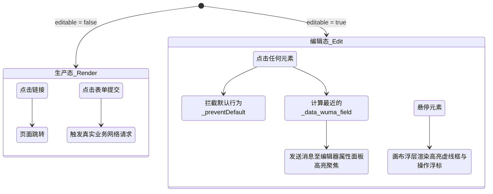
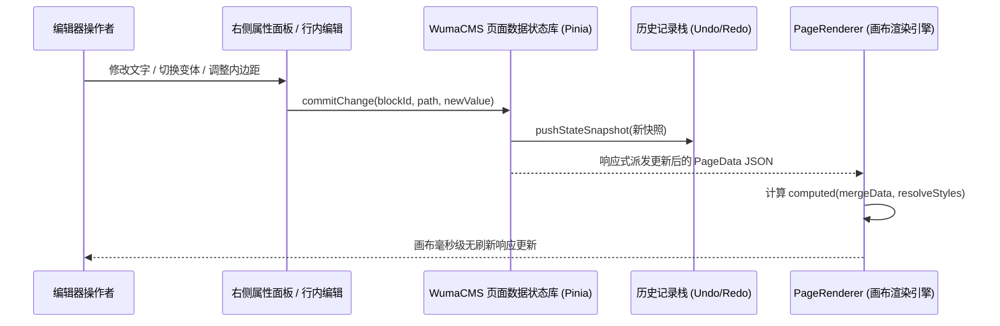
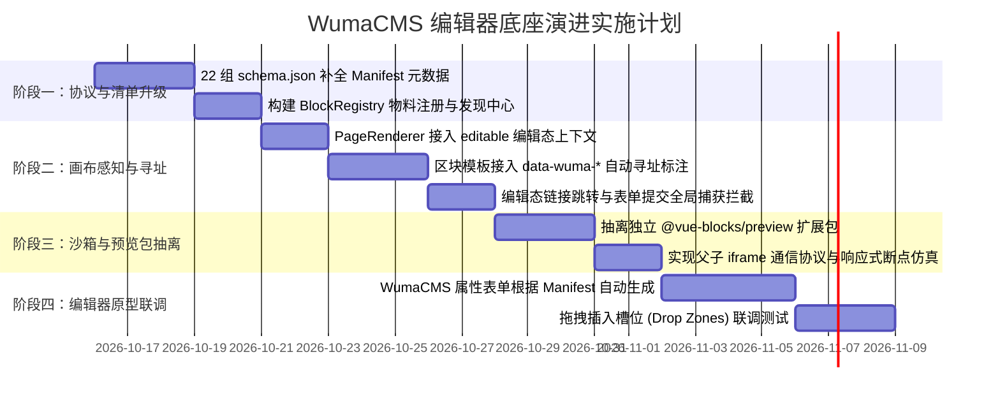

# WumaCMS 可视化编辑器与 vue-blocks 组件库融合详细设计文档

- **项目名称**：WumaCMS 可视化页面搭建引擎（Visual Page Builder Engine）
- **底层依赖**：`vue-blocks`（Vue 3 + Tailwind CSS 4 企业级区块组件库）
- **文档版本**：v1.0.0
- **编写日期**：2026-10-15
- **当前状态**：设计评审中（Proposed）

---

## 1. 概述与设计愿景

### 1.1 背景与目标
`vue-blocks` 目前已具备完善的 22 组原子区块组件、单页渲染器（`PageRenderer`）、全站渲染器（`SiteRenderer`）以及基于 OKLCH 的多风格变体系统，并为各区块配备了基础 `schema.json`。

为了支撑未来 **WumaCMS 可视化编辑器（零代码/低代码建站系统）**，组件库需要从单纯的“面向开发者的代码型 UI 库”，演进为**“支持可视化编辑态双向感知的低代码核心底座”**。

### 1.2 核心设计原则
1. **纯净运行时（Zero Runtime Overhead）**：发布态（生产环境）绝对零性能损耗与零冗余代码，编辑态逻辑全部按需激活或抽离。
2. **纯数据单向流（Strict JSON Serializability）**：页面与站点完全由可 JSON 序列化的配置驱动，天然支持撤销/重做（Undo/Redo）、多端协作与服务端存储。
3. **DOM 恒定与寻址精准（DOM Constancy & Precise Addressing）**：切换变体或样式不销毁重建 DOM，且画布上的所有关键视觉元素均具备清晰的数据寻址标记（Click-to-Select）。
4. **协议驱动表单（Schema-Driven Forms）**：编辑器属性面板（Inspector）完全基于标准化 Manifest 自动生成，新增或扩展区块无需手写配置界面。
5. **沙箱与样式完全隔离（Strict Sandbox & Style Isolation）**：编辑器本身的 UI 样式（如 Tailwind 工具栏、弹窗）与画布内部的区块渲染严格解耦，互不污染。

---

## 2. 总体架构全景

```mermaid
graph TB
    subgraph WumaCMS_Editor [WumaCMS 可视化编辑器系统]
        subgraph Material_Palette [物料中心面板]
            CategoryList[分类过滤]
            BlockThumbnails[区块卡片与拖拽源]
        end
        
        subgraph Canvas_Area [可视化视口画布]
            ViewportSimulator[多设备视口 PC/Pad/Mobile]
            SandboxIframe[独立沙箱 Iframe / 容器]
            HighlighterOverlay[悬停高亮 / 选中框 / 间隙插槽]
        end
        
        subgraph Property_Inspector [属性检查器面板]
            ContentForm[内容表单 Schema Form]
            StyleConfigurator[样式与布局面板]
            VariantPicker[4大风格变体切换]
            ThemeHuePicker[OKLCH 品牌色彩选择器]
        end
    end

    subgraph Editor_Bridge [编辑态桥接层 @vue-blocks/editor]
        CanvasContext[EditMode Context Provider]
        DOMInspector[DOM 拾取与数据路径追踪]
        EventInterceptor[链接/表单事件拦截机制]
        MessageBridge[父子窗口 PostMessage 双向总线]
    end

    subgraph VueBlocks_Core [vue-blocks 核心层]
        BlockRegistry[物料注册中心 BlockRegistry]
        PageRendererComp[PageRenderer 页面渲染引擎]
        SiteRendererComp[SiteRenderer 站点渲染引擎]
        Blocks22[22 组原子区块 (Hero, Navbar...)]
        Manifests[物料全貌清单 Manifest Protocol]
    end

    Material_Palette -->|读取物料列表与分类| BlockRegistry
    BlockRegistry -->|注册与发现| Manifests
    Property_Inspector -->|根据 fields 动态生成| Manifests
    Property_Inspector -->|更新 PageData| Canvas_Area
    Canvas_Area -->|加载渲染| PageRendererComp
    Canvas_Area <-->|事件通信与 DOM 拾取| Editor_Bridge
    Editor_Bridge -->|上下文渗透| PageRendererComp
    PageRendererComp -->|实例化区块| Blocks22
```

---

## 3. 核心规范一：物料全貌清单协议（Material Manifest Protocol）

目前各区块的 `schema.json` 仅描述了 `data` 内部字段。升级后的物料全貌清单（`Manifest`）将成为 WumaCMS 编辑器的“单一真理源”（Single Source of Truth）。

### 3.1 Manifest TypeScript 类型定义

```typescript
export interface BlockManifest {
  /** 区块唯一类型标识，例如 'HeroBlock' */
  name: string
  /** 编辑器中显示的中文名称，例如 '主视觉首屏' */
  title: string
  /** 区块分类：用于左侧物料分类抽屉 */
  category: 'base' | 'content' | 'conversion' | 'list' | 'footer'
  /** 图标名称（对应 Lucide 图标或 SVG 标识） */
  icon: string
  /** 区块功能简述 */
  description: string
  /** 缩略图地址（用于物料卡片展示） */
  thumbnail?: string
  /** 区块能力声明 */
  supports: {
    /** 是否支持风格变体（1, 2, 3, 4） */
    variant: boolean
    /** 是否支持动态 OKLCH 主题色渗透 */
    theme: boolean
    /** 暴露给可视化编辑的可配样式槽位列表 */
    styleSlots: Array<{
      slot: string          // 如 'root', 'container', 'title'
      label: string         // 如 '外层容器', '主体居中容器', '主标题文字'
      allowedProps: Array<'background' | 'spacing' | 'typography' | 'border' | 'shadow'>
    }>
    /** 插槽扩展能力声明 */
    customSlots?: Array<{
      name: string
      label: string
      description: string
    }>
  }
  /** 业务数据 Schema 字段列表（直接驱动右侧表单渲染） */
  fields: ManifestField[]
}

export type ManifestFieldType =
  | 'text'          // 单行文本输入
  | 'textarea'      // 多行文本（支持 HTML/换行）
  | 'richtext'      // 富文本（支持粗体、链接、高亮）
  | 'image'         // 图片选择器（支持 URL 输入与媒体库选择）
  | 'boolean'       // 开关 Switch
  | 'select'        // 单选下拉框
  | 'color'         // 颜色选择器
  | 'icon'          // 图标选择器
  | 'repeater'      // 数组列表（支持拖拽排序、增删项）
  | 'link'          // 链接选择器（内部页面路由/外部 URL/锚点）

export interface ManifestField {
  name: string
  label: string
  type: ManifestFieldType
  default?: any
  placeholder?: string
  help?: string
  /** 选项列表（当 type === 'select' 时有效） */
  options?: Array<{ label: string; value: any }>
  /** 重复器子字段（当 type === 'repeater' 时有效） */
  fields?: ManifestField[]
  /** 字段校验规则 */
  validation?: {
    required?: boolean
    min?: number
    max?: number
    pattern?: string
  }
  /** 条件联动显示：例如当 newWindow === true 时展示某些额外字段 */
  showWhen?: {
    field: string
    equals: any
  }
}
```

### 3.2 典型 Manifest 示例（以 `HeroBlock` 为例）

```json
{
  "name": "HeroBlock",
  "title": "主视觉首屏",
  "category": "base",
  "icon": "LayoutTemplate",
  "description": "企业级首屏展示区块，支持主副标题、主次行动按钮与主媒体展示",
  "thumbnail": "/thumbnails/hero-block.webp",
  "supports": {
    "variant": true,
    "theme": true,
    "styleSlots": [
      { "slot": "root", "label": "首屏外层容器", "allowedProps": ["background", "spacing"] },
      { "slot": "title", "label": "主标题排版", "allowedProps": ["typography"] },
      { "slot": "description", "label": "副标题文案", "allowedProps": ["typography"] },
      { "slot": "buttonPrimary", "label": "主按钮样式", "allowedProps": ["background", "border", "shadow"] }
    ],
    "customSlots": [
      { "name": "title", "label": "自定义标题插槽", "description": "完全接管主标题区域" },
      { "name": "actions", "label": "自定义行动按钮组", "description": "插入自定义按钮或表单" },
      { "name": "media", "label": "自定义多媒体插槽", "description": "替换图片为视频或 3D 动效" }
    ]
  },
  "fields": [
    {
      "name": "title",
      "label": "主标题文字",
      "type": "textarea",
      "default": "企业级即时通讯<br>让协作更快一步",
      "help": "支持使用 <br> 换行和 <strong> 突出重点"
    },
    {
      "name": "description",
      "label": "副标题描述",
      "type": "textarea",
      "default": "安全、高效、可定制——专为现代企业打造的智能聊天平台。"
    },
    {
      "name": "buttons",
      "label": "行动按钮列表",
      "type": "repeater",
      "fields": [
        { "name": "btnText", "label": "按钮文本", "type": "text" },
        { "name": "btnLink", "label": "跳转链接", "type": "link" },
        { "name": "isPrimary", "label": "设为主行动按钮", "type": "boolean" },
        { "name": "newWindow", "label": "新窗口打开", "type": "boolean" }
      ],
      "default": [
        { "btnText": "开始免费使用", "btnLink": "#", "isPrimary": true, "newWindow": false },
        { "btnText": "联系销售团队", "btnLink": "#", "isPrimary": false, "newWindow": false }
      ]
    },
    {
      "name": "image",
      "label": "视觉封面图",
      "type": "image",
      "default": "https://images.unsplash.com/photo-1557804506-669a67965ba0?auto=format&fit=crop&w=900&q=60",
      "help": "推荐 16:9 比例高清素材"
    }
  ]
}
```

---

## 4. 核心规范二：画布 DOM 寻址与数据标注协议（Data-Path Addressing）

为解决可视化画布中“点击文字/按钮无法定位到 JSON 属性”的问题，制定如下 DOM 标注规范。

### 4.1 属性定义与规范约定

在组件库处于编辑模式（`editable === true`）时，系统自动或通过轻量指令注入以下 HTML `data-*` 属性：

| 属性名 | 挂载层级 | 说明 | 示例 |
| :--- | :--- | :--- | :--- |
| `data-wuma-block-id` | 区块根节点 `<section>` | 当前区块在页面 JSON 中的唯一 ID | `data-wuma-block-id="hero-8x7a"` |
| `data-wuma-block-type` | 区块根节点 `<section>` | 当前区块对应的组件名 | `data-wuma-block-type="HeroBlock"` |
| `data-wuma-block-index` | 区块根节点 `<section>` | 区块在页面中的当前数组索引 | `data-wuma-block-index="0"` |
| `data-wuma-field` | 内部视觉原子元素 | 当前元素对应的数据字段名（支持点语法） | `data-wuma-field="title"` |
| `data-wuma-field-path` | 列表/嵌套项元素 | 数组嵌套结构中的精准索引路径 | `data-wuma-field-path="buttons.0.btnText"` |
| `data-wuma-slot` | 插槽包装容器 | 对应插槽标识 | `data-wuma-slot="actions"` |

### 4.2 编辑态下的 DOM 输出效果示例

```html
<!-- 生产发布态输出：纯净无标记 -->
<section class="bg-background pt-16 pb-20 ...">
  <div class="max-w-7xl mx-auto ...">
    <h1 class="text-4xl ...">企业级即时通讯</h1>
  </div>
</section>

<!-- 编辑态输出：带精准寻址属性 -->
<section
  id="hero-8x7a"
  class="bg-background pt-16 pb-20 ..."
  data-wuma-block-id="hero-8x7a"
  data-wuma-block-type="HeroBlock"
  data-wuma-block-index="0"
>
  <div class="max-w-7xl mx-auto ...">
    <h1 class="text-4xl ..." data-wuma-field="title">企业级即时通讯</h1>
    <p class="text-lg ..." data-wuma-field="description">安全、高效、可定制...</p>
    <div class="flex gap-4 ..." data-wuma-slot="actions">
      <a class="px-6 py-3 ..." data-wuma-field-path="buttons.0.btnText">开始免费使用</a>
      <a class="px-6 py-3 ..." data-wuma-field-path="buttons.1.btnText">联系销售团队</a>
    </div>
  </div>
</section>
```

### 4.3 零侵入实现方案：统一 Provider 与字段标注包装

为避免开发者在 22 个组件的模板中手动硬编码大量繁琐的 `data-wuma-*`，在 `@vue-blocks/utils` 中提供**编辑态感知指令/辅助包装**：
* 生产态下该辅助函数为**纯透传恒等函数**，无任何 DOM 标记与开销；
* 仅当通过 Vue `provide('WUMA_EDITOR_MODE', true)` 激活时，才自动挂载 `data-*` 属性。

---

## 5. 核心规范三：编辑态运行时环境与事件隔离控制

### 5.1 交互事件接管原则
在可视化编辑状态下，画布中的用户手势意图与真实浏览完全不同：



### 5.2 全局编辑事件捕获器（`useCanvasEventBridge`）
在 `PageRenderer` 或画布根节点上通过事件捕获阶段（Capture Phase）进行统一治理，无需修改每一个 `<a href>`：

```typescript
export function setupCanvasEventBridge(canvasRoot: HTMLElement, onSelectElement: (payload: SelectedPayload) => void) {
  // 1. 拦截所有链接跳转
  canvasRoot.addEventListener('click', (e: MouseEvent) => {
    const target = e.target as HTMLElement
    if (!target) return

    // 处于编辑模式，全量阻止原生链接跳转和按钮提交
    e.preventDefault()
    e.stopPropagation()

    // 向上寻找具有 data-wuma 属性的目标元素
    const fieldEl = target.closest('[data-wuma-field], [data-wuma-field-path]') as HTMLElement | null
    const blockEl = target.closest('[data-wuma-block-id]') as HTMLElement | null

    if (blockEl) {
      onSelectElement({
        blockId: blockEl.getAttribute('data-wuma-block-id') || '',
        blockType: blockEl.getAttribute('data-wuma-block-type') || '',
        blockIndex: Number(blockEl.getAttribute('data-wuma-block-index') || 0),
        fieldName: fieldEl?.getAttribute('data-wuma-field') || undefined,
        fieldPath: fieldEl?.getAttribute('data-wuma-field-path') || undefined,
        targetRect: (fieldEl || blockEl).getBoundingClientRect()
      })
    }
  }, true) // 使用捕获模式，确保早于组件自身绑定的 click 执行
}
```

---

## 6. 核心规范四：动态物料注册中心（BlockRegistry）

目前所有组件硬编码引入在 `blockMap.js` 中。升级为动态的物料注册系统，以支持将来企业用户、插件开发者动态扩展自定义私有区块。

### 6.1 `BlockRegistry` 核心 API

```typescript
// @vue-blocks/core / BlockRegistry.ts
import type { Component } from 'vue'
import type { BlockManifest } from './manifest'

export interface BlockEntry {
  type: string
  component: Component
  manifest: BlockManifest
  defaultData: Record<string, any>
  defaultStyles: Record<string, any>
}

class MaterialRegistry {
  private blocks = new Map<string, BlockEntry>()

  /** 注册内置或外部自定义区块 */
  register(entry: BlockEntry): void {
    if (this.blocks.has(entry.type)) {
      console.warn(`[BlockRegistry] 区块类型 ${entry.type} 已存在，正在被覆盖。`)
    }
    this.blocks.set(entry.type, entry)
  }

  /** 获取单个区块信息 */
  get(type: string): BlockEntry | undefined {
    return this.blocks.get(type)
  }

  /** 获取所有已注册区块组件映射（用于 PageRenderer） */
  getComponentMap(): Record<string, Component> {
    const map: Record<string, Component> = {}
    this.blocks.forEach((entry, key) => {
      map[key] = entry.component
    })
    return map
  }

  /** 获取全量物料清单（用于编辑器左侧物料托盘） */
  getAllManifests(): BlockManifest[] {
    return Array.from(this.blocks.values()).map(e => e.manifest)
  }

  /** 按分类获取物料清单 */
  getManifestsByCategory(category: string): BlockManifest[] {
    return this.getAllManifests().filter(m => m.category === category)
  }
}

export const blockRegistry = new MaterialRegistry()
```

### 6.2 在 `PageRenderer` 中的无缝调度
`PageRenderer` 中的 `resolveBlock(type)` 改造为：
1. 先从 `blockRegistry.get(type)` 获取；
2. 若未注册，则回退至 Vue 全局已注册组件（`app.component(type)`）；
3. 依然未找到时，渲染优雅的容错占位区块（“未找到对应区块类型”），并在控制台输出清晰警告。

---

## 7. 核心规范五：双向响应式更新与行内即时编辑管线

### 7.1 数据流更新管道（Data Pipeline）



### 7.2 行内即时编辑（In-Place Editing）实现策略
对于支持双击直接编辑的标题或段落，提供轻量开关：
1. 用户在画布上双击带有 `data-wuma-field` 的文字；
2. 触发编辑器画布激活一个悬浮在目标元素上方的独立 `contenteditable` 临时输入框（或直接让目标元素进入 `contenteditable="true"`）；
3. 在 `blur` 或按下回车时，提取最终纯文本，通过事件派发：
   `emit('update-field', { blockId, fieldPath: 'title', value: newText })`；
4. 保证底层真实 JSON 数据严格同步，彻底避免直接操作底层 DOM 导致的 Vue VDOM 错位。

---

## 8. 核心规范六：多端视口仿真与独立沙箱架构

延续并提升关于预览组件的架构洞察，将文档与编辑器通用的预览与设备视口能力抽离为扩展包。

### 8.1 `@vue-blocks/preview` 模块分层

```bash
packages/preview/
  ├── DeviceFrame.vue          # 纯拟物设备视口外框 (PC 100%, iPad 768px, Mobile 375px)
  ├── ViewportSimulator.vue    # 包含缩放比例 (Fit to screen)、横竖屏切换的容器
  ├── SandboxBridge.ts         # iframe postMessage 通信中继器 (高度自适应, 主题同步)
  ├── BlockPreview.vue         # 面向文档/卡片的单区块自适应高度展示器
  ├── PagePreview.vue          # 面向单页落地页的完整滚动沙箱
  └── SitePreview.vue          # 面向全站的 Memory 路由沙箱
```

### 8.2 样式隔离保障
* **编辑器工作区**：运行在主应用 DOM 树中，包含复杂的管理后台组件库、深色侧边栏、拖拽工具条；
* **页面编辑画布**：强烈建议放置在**同源子 Iframe** 中：
  * 杜绝编辑器后台的 CSS 规则穿透或覆盖用户站点的 Tailwind 4 原子类；
  * 真实仿真媒体查询（`@media (max-width: 768px)`），因为主窗口缩放无法触发纯 `div` 的 `@media` 断点，而只有独立视口 `iframe` 才能真实触发响应式媒体查询！

---

## 9. 实施演进路线图（Implementation Roadmap）



---

## 10. 评估结论

通过本设计方案：
1. **现有架构无需推倒重来**：当前建立的“单模板直出 + OKLCH 4 层主题解耦 + 纯数据配置驱动”是完全正确且先进的，所有优化均属于**非破坏性的渐进式增强**；
2. **打通可视化搭建的最后一公里**：通过引入标准化 `Manifest` 清单、`BlockRegistry` 注册中心以及 `data-wuma-*` 元素寻址协议，彻底消除了“页面代码与可视化编辑器之间的信息孤岛”；
3. **生态可扩展**：未来不仅官方的 22 组区块可以随时被编辑器编排，第三方开发者遵循此规范开发的自定义区块，也能无缝接入 WumaCMS 进行拖拽搭建。
